# ThermalSense

**From one triangle to an autonomous outpost.** Final project of the Computer Graphics Laboratory (CSE 4102), Department of Computer
Science and Engineering, KUET. Md. Shakhoyat Rahman Shujon, Roll 2107104.

A playable military outpost in C++17 and OpenGL 3.3 (4.3 compute for the ray tracers). The camp, the vehicles and the soldiers are
built from 16 shape generators written for the project: 5,474 parts in 62 designs, no model files (the trees at the two highest
presets are public-domain meshes). There is no mathematics library, no shader calls a built-in vector function, and the sound is
synthesised. On top of the graphics pipeline run a thermal camera model, an image-processing pipeline, a multi-target tracker, two
drones that decide together how to strike, intruders that plan routes and hide, and soldiers with duties.

<a href="docs/FILM_SCRIPT.md">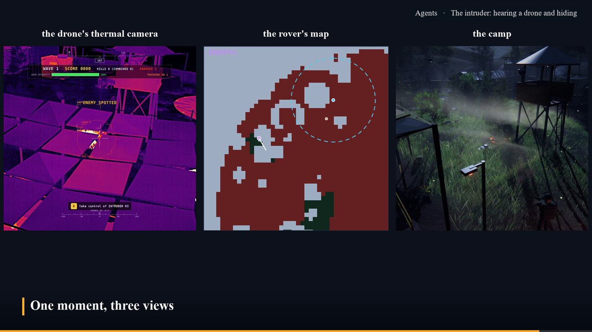</a>

## Start here

| To see | Open |
| --- | --- |
| **The film** (39:35, narrated, with chapters) | YouTube link: *to be added after the upload*; copies in this repository by part: [part 1](report/video/thermalsense_full_part1.mp4), [part 2](report/video/thermalsense_full_part2.mp4), [part 3](report/video/thermalsense_full_part3.mp4), [part 4](report/video/thermalsense_full_part4.mp4), [part 5](report/video/thermalsense_full_part5.mp4) |
| The film's narration and shot list | [`docs/FILM_SCRIPT.md`](docs/FILM_SCRIPT.md); subtitles [`docs/FILM_SUBTITLES.srt`](docs/FILM_SUBTITLES.srt); chapter list [`docs/FILM_CHAPTERS.txt`](docs/FILM_CHAPTERS.txt) |
| **The report** (186 pages) | [`report/main.pdf`](report/main.pdf) |
| **The workbook** (23 sheets; the register of every number and coordinate) | [`report/workbooks/cg_workbook.xlsx`](report/workbooks/cg_workbook.xlsx) |
| A tour of the code, line by line, in pipeline order | [`docs/CODE_TOUR.md`](docs/CODE_TOUR.md) |
| Every report section mapped to its code | [`docs/REPORT_CODE_MAP.md`](docs/REPORT_CODE_MAP.md) |
| The slides | [10 slides](report/ThermalSense_Presentation_10.pptx), [25 slides](report/ThermalSense_Presentation.pptx) |
| The short film (3 min 38 s) | [1080p](report/video/thermalsense_final_1080p_web.mp4), [720p](report/video/thermalsense_final_720p.mp4) |

## The film, chapter by chapter

The film goes through every topic of the graphics laboratory first, then the techniques beyond it and the algorithms of the
outpost. Each chapter draws the idea one step at a time and then shows the same thing in the running program.

| Time | Part | Chapter |
| --- | --- | --- |
| 0:00 |  | ThermalSense |
| 1:14 | Orientation | The outpost |
| 2:39 | Geometry | Primitives: from a triangle to sixteen shapes |
| 4:55 | Geometry | Transformations and the scene graph |
| 6:17 | Viewing | Viewing and projection |
| 7:40 | Viewing | Clipping and hidden surfaces |
| 9:13 | Viewing | Rasterisation and colour interpolation |
| 10:46 | Light | Illumination |
| 12:19 | Light | Shading: flat, Gouraud, Phong |
| 12:58 | Light | Texture mapping |
| 13:32 | Light | Ray tracing |
| 14:41 | Rendering | Materials that behave like the real thing |
| 15:28 | Rendering | Shadows and ambient occlusion |
| 16:07 | Rendering | The camera as an eye |
| 17:34 | Rendering | Scale and speed |
| 18:34 | World | Day, night and weather |
| 19:37 | World | Sound synthesis |
| 20:07 | Control | Buildings you can walk into |
| 21:15 | Control | Take control of anything |
| 23:16 | Control | Jump into anything that moves |
| 24:50 | Control | The garrison's day |
| 26:38 | Vision | The thermal camera |
| 27:59 | Vision | From a heat picture to a target |
| 29:32 | Vision | Tracking |
| 30:57 | Agents | The drones |
| 31:41 | Agents | One drone, or both? |
| 33:23 | Agents | The intruder: choosing a route |
| 34:33 | Agents | The intruder: following the line |
| 35:27 | Agents | The intruder: hearing a drone and hiding |
| 36:14 | Agents | The game, and the blast |
| 37:34 | Engineering | Hard problems |
| 38:03 | Engineering | How it is checked |
| 38:38 |  | One night at the outpost |

<table><tr>
<td width="50%">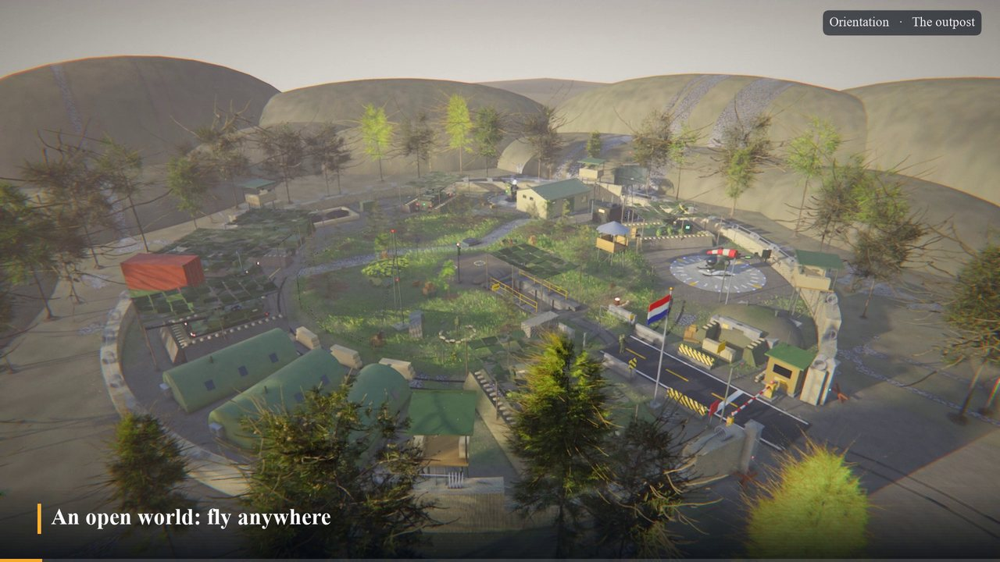<br><sub>An open world: the camera is free</sub></td>
<td width="50%">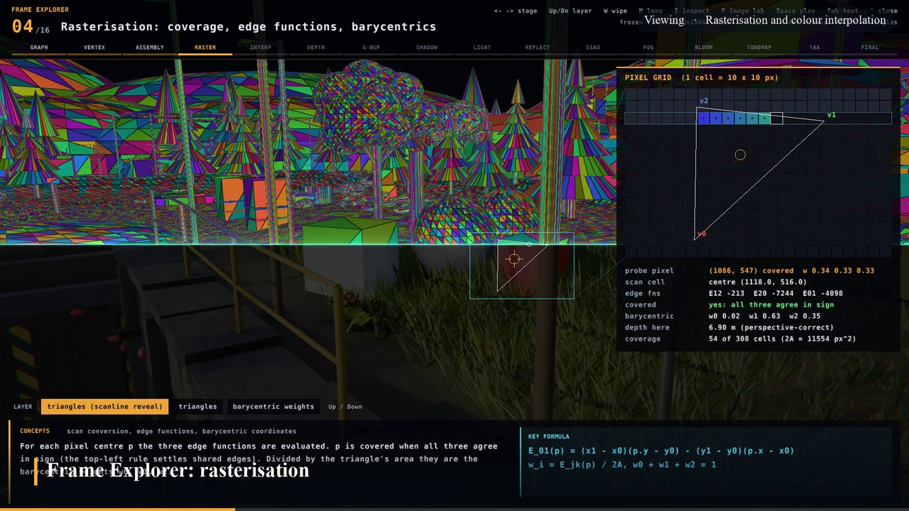<br><sub>Frame Explorer: one frame replayed in 16 stages</sub></td>
</tr></table>

<table><tr>
<td width="50%">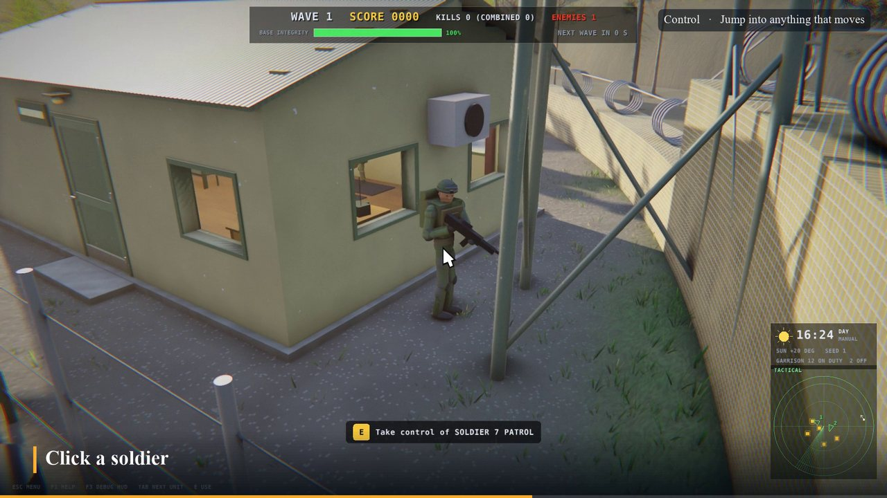<br><sub>Click a walking soldier ...</sub></td>
<td width="50%">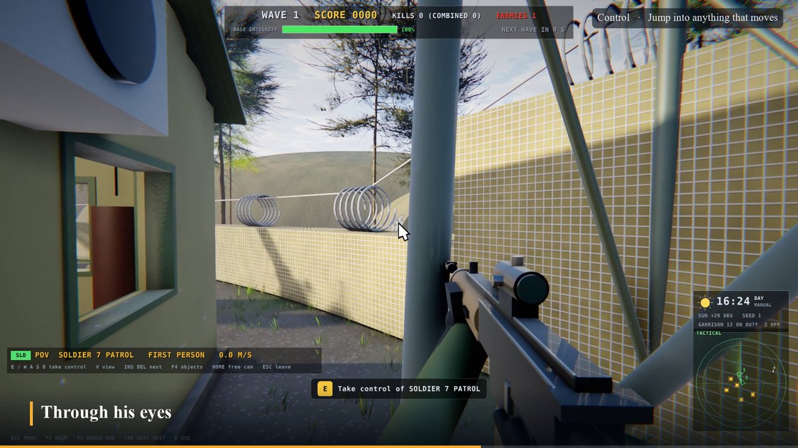<br><sub>... and see through his eyes</sub></td>
</tr></table>

<table><tr>
<td width="50%">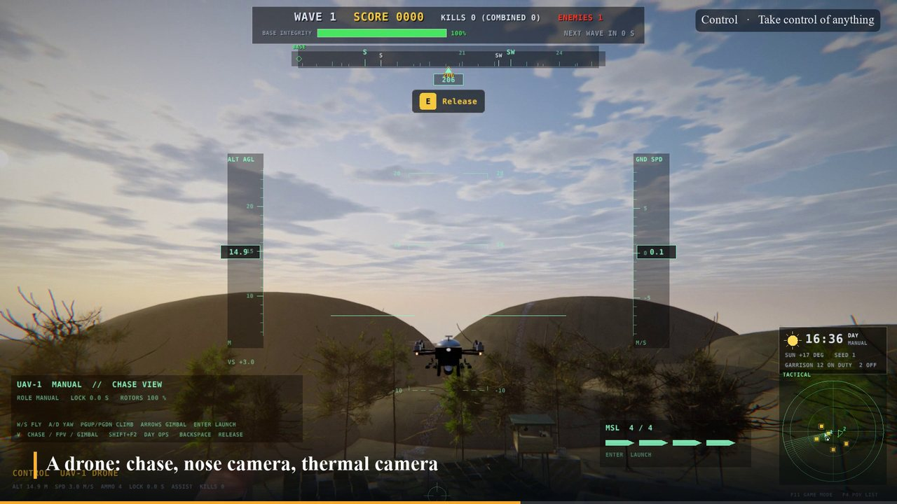<br><sub>A drone flown by hand, with its flight display</sub></td>
<td width="50%">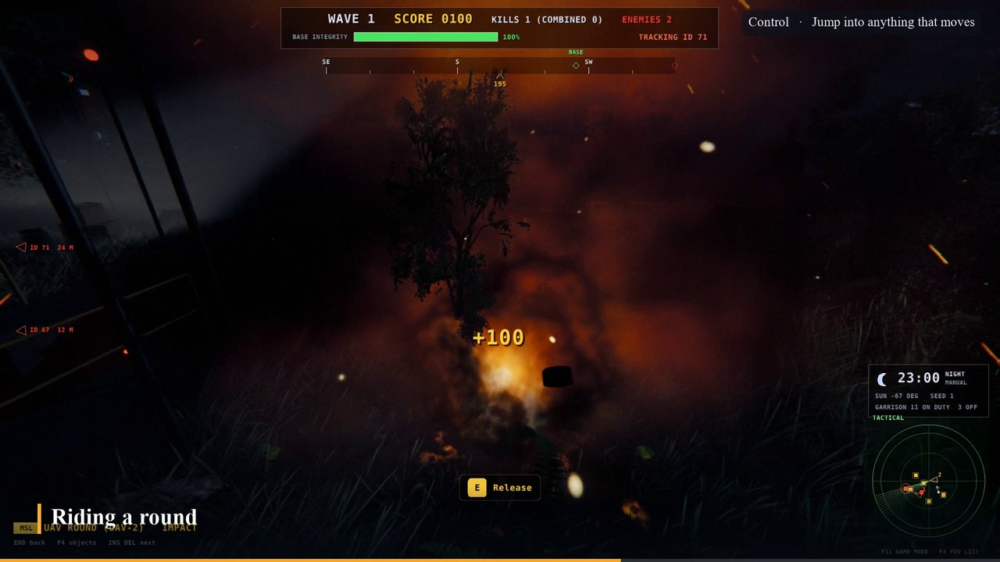<br><sub>Riding a round to its target</sub></td>
</tr></table>


## 1. Geometry: 16 generators, 5,474 parts

<table><tr>
<td width="50%">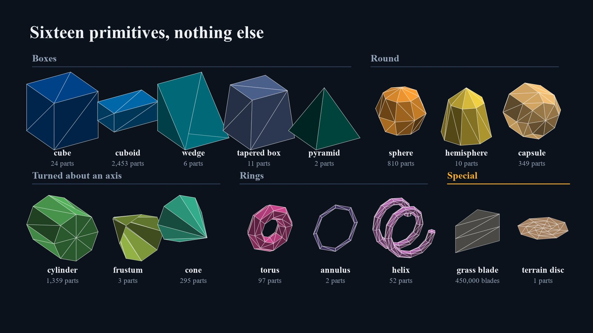<br><sub>The sixteen primitives</sub></td>
<td width="50%">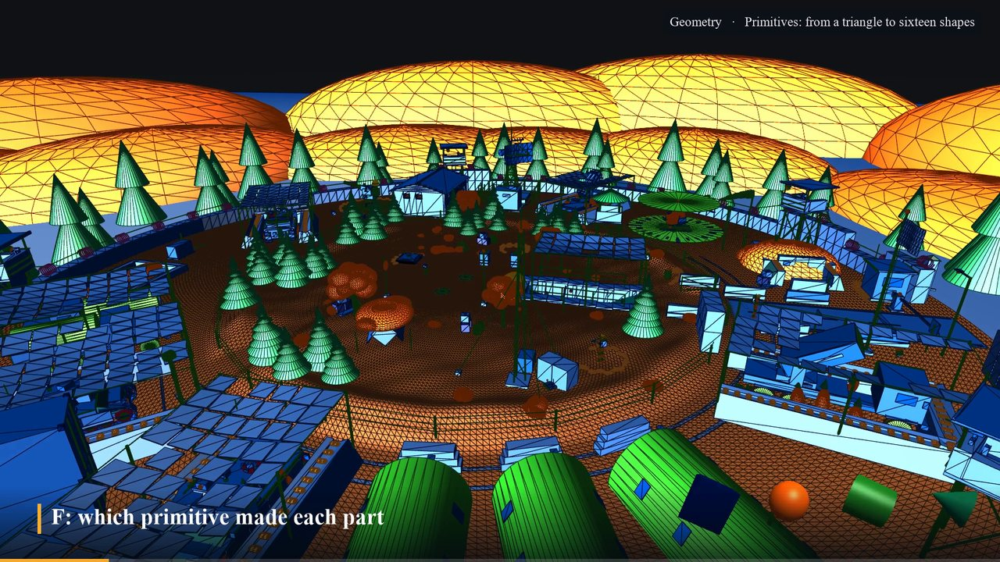<br><sub>Key F: every part coloured by the generator that made it</sub></td>
</tr></table>

| # | Primitive | Corners V | Triangles T | V | T | Parts in the scene |
| --- | --- | ---: | ---: | --- | --- | ---: |
| 1 | cube | 24 | 12 | `6 faces x 4 corners` | `6 faces x 2` | 24 |
| 2 | cuboid | 24 | 12 | `6 faces x 4 corners (the cube mesh)` | `6 faces x 2` | 2,453 |
| 3 | sphere | 614 | 1,224 | `(k - 1) s + 2` | `2 s (k - 1)` | 810 |
| 4 | hemisphere | 362 | 648 | `s (k + 1) + 2` | `2 s k` | 10 |
| 5 | cylinder | 146 | 144 | `4 s + 2` | `4 s` | 1,359 |
| 6 | frustum | 72 | 72 | `2 s` | `2 s` | 3 |
| 7 | cone | 109 | 72 | `3 s + 1` | `2 s` | 295 |
| 8 | torus | 576 | 1,152 | `u v` | `2 u v` | 97 |
| 9 | wedge | 18 | 8 | `3 quads x 4 + 2 triangles x 3 = 18` | `3 x 2 + 2 x 1 = 8` | 6 |
| 10 | tapered box | 24 | 12 | `6 faces x 4 = 24` | `6 x 2 = 12` | 11 |
| 11 | pyramid | 16 | 6 | `4 + 4 sides x 3 = 16` | `2 + 4 = 6` | 2 |
| 12 | capsule | 98 | 192 | `2 c s + 2` | `4 c s` | 349 |
| 13 | annulus | 192 | 192 | `4 n` | `4 n` | 2 |
| 14 | helix | 740 | 1,452 | `(n + 1) m + 2 (m + 1)` | `2 n m + 2 m` | 52 |
| 15 | grass blade | 7 | 5 | `2 x 3 rows + tip = 7` | `2 x 2 segments + tip = 5` | instanced blades |
| 16 | terrain disc | 49,921 | 97,440 | `1 + k s` | `s (2 k - 1) - D` | 1 |

An object is a list of parts; a part is one generator call and one matrix `M = T R S`. The 62 designs:

| Family | Designs | Parts |
| --- | --- | ---: |
| people | soldier x8 | 600 |
| vehicles and aircraft | main battle tank x3, mlrs rocket truck, scout helicopter, autonomous uav x2, cargo truck x2, target rover x6 | 1,290 |
| weapons and munitions | sam launcher, aa gatling gun, sam missile, mlrs rocket x6, uav round x8, aa shell casing x20 | 268 |
| buildings | command bunker, barracks hall, air-defence radar, motor pool, helipad, ammunition bunker, guard tower x4, watchtower, fuel depot, quonset hut x3, radio mast, camouflaged tent, container x2, guard booth, uav pad x2 | 1,215 |
| fortifications | hesco perimeter, concertina wire, perimeter fence, outer gate, camouflage net x7, earth revetment x5, radar surround, aa gun surround, sandbag wall x3, boom barrier, hesco blocks x2, tank trap x2, jersey barrier x6 | 1,302 |
| vegetation | broadleaf tree x4, pine x26, cut branches x8, bush x14, treeline pine x43 | 535 |
| props | flag, windsock, supply cache x7, boulder x13, lamp post x2, track sign, fire barrel, sky clock (sun), moon | 165 |
| terrain and backdrop | terrain disc, far ground x4, distant hills, far radio tower, road, tyre tracks, tank spot marking | 99 |

<table><tr>
<td width="50%">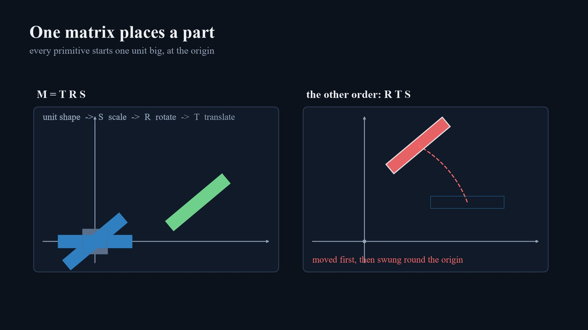<br><sub>One matrix places a part; the order matters</sub></td>
<td width="50%">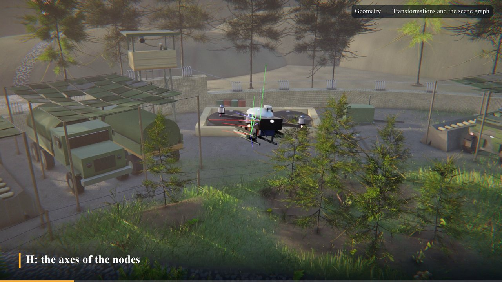<br><sub>Key H: the local axes of the nodes of the scene graph</sub></td>
</tr></table>


## 2. The pipeline: what was compared, and what was chosen

| Stage | Idea | Compared | Chosen | Keys in the program |
| --- | --- | --- | --- | --- |
| Viewing | look-at basis, perspective divide | perspective / orthographic / isometric | perspective to play, the parallel views to teach | `Ctrl+P` |
| Clipping, visibility | Cohen-Sutherland, Liang-Barsky, depth buffer | painter's sorting / depth buffer | 24-bit depth, near 0.05 m, far 600 m | `Z`, `F`, `X` |
| Rasterisation | edge functions, barycentric weights | none / multisampling / temporal | 4x multisampling + temporal anti-aliasing | `` ` `` (Frame Explorer), `F6` |
| Illumination | ambient + diffuse + specular, written out (`ts*` functions) | one term at a time | all lights summed per pixel | `Ctrl+L`, `1`-`4` |
| Shading | where the light is computed | flat / Gouraud / Phong; Blinn-Phong / microfacet | per-pixel shading, microfacet highlights | `O`, `B` |
| Shadows | shadow maps, soft edge by blocker distance | hard / filtered / contact-hardening | cascades with soft edges, contact shadows | - |
| Tone | exposure, tone curve, gamma | clipped / tone-mapped | eye adaptation + tone curve | `=`, `-`, `N` |
| Reflection, ray tracing | reflect, refract, tree of boxes | screen-space / hybrid / Whitted / path | raster + screen-space to play, ray tracing on a key | `;`, `'`, `F7` |

<table><tr>
<td width="50%">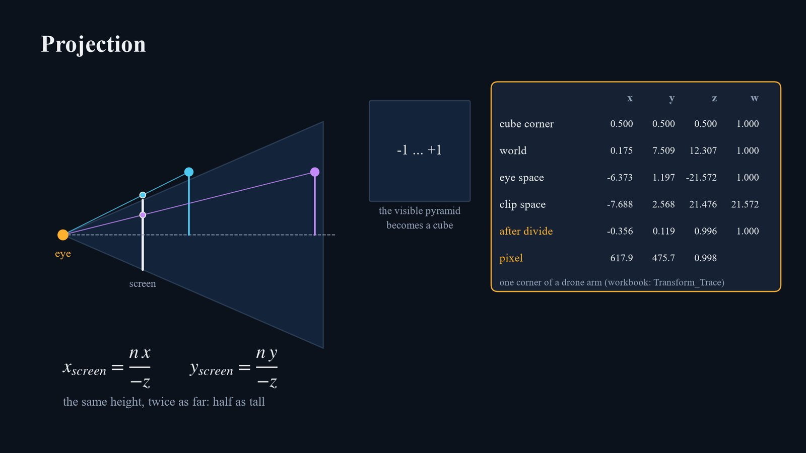<br><sub>One real vertex from the generator to its pixel (workbook: Transform_Trace)</sub></td>
<td width="50%">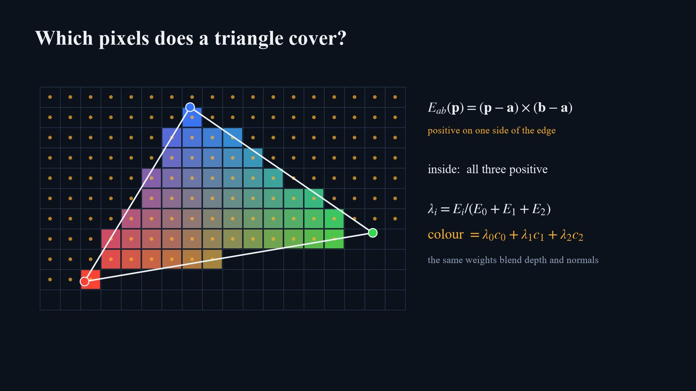<br><sub>Edge functions fill a triangle</sub></td>
</tr></table>

<table><tr>
<td width="50%">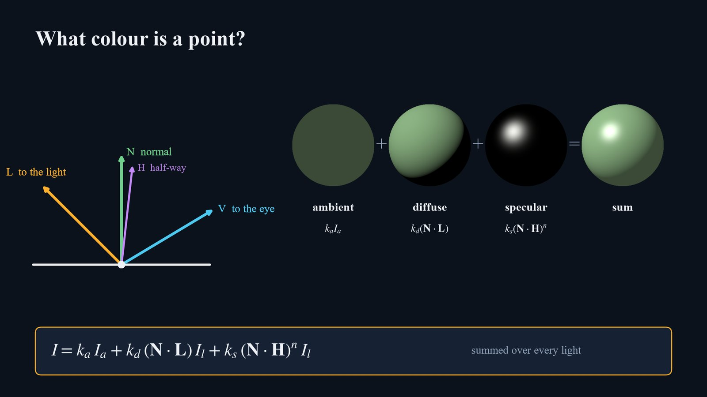<br><sub>Ambient + diffuse + specular</sub></td>
<td width="50%">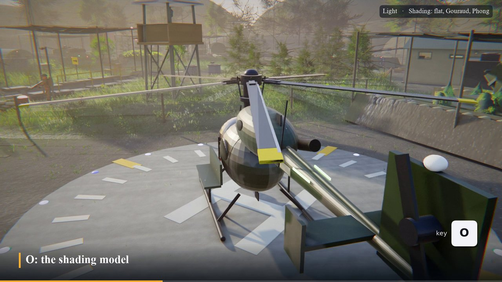<br><sub>Key O: flat, Gouraud, Phong on the helicopter</sub></td>
</tr></table>

<table><tr>
<td width="50%">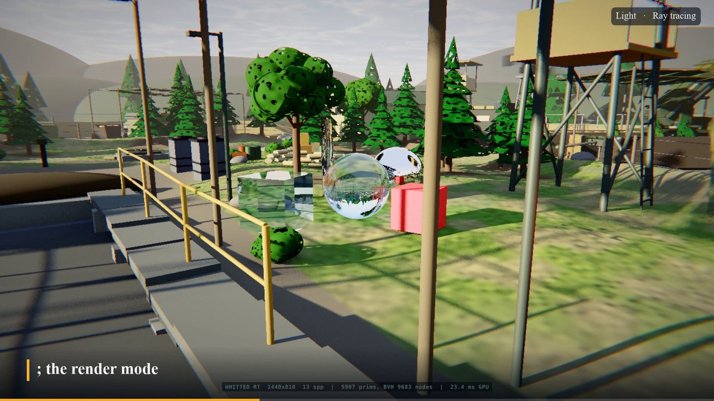<br><sub>Key ; switches between five renderers</sub></td>
<td width="50%">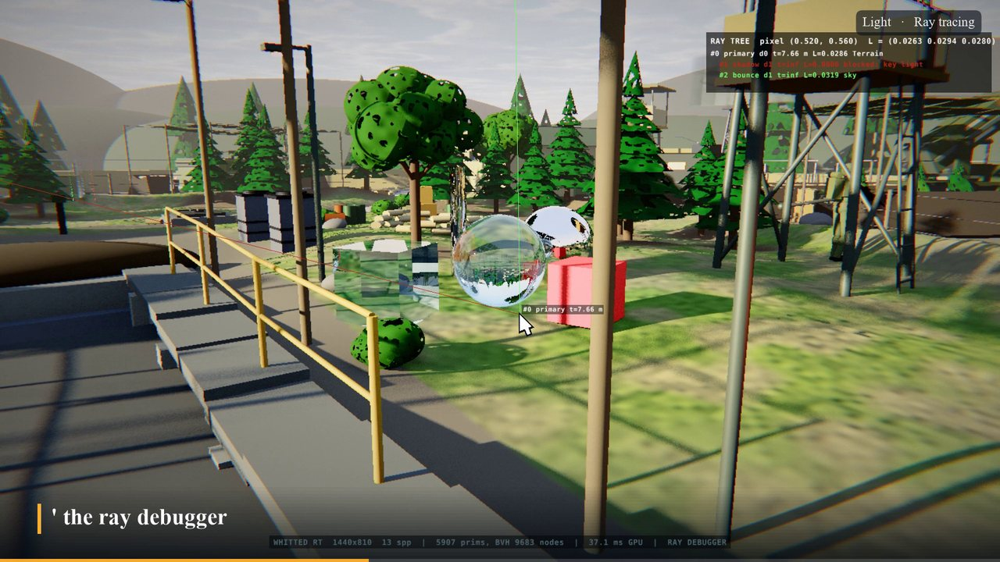<br><sub>The ray debugger: the tree of rays behind one pixel</sub></td>
</tr></table>


Frame time per preset (1920 x 1080, RTX 4070; `report/data/bench.csv`):

| Configuration | ms per frame | frames per second | triangles |
| --- | ---: | ---: | ---: |
| EPIC day 10:30 | 11.9 | 84 | 4,112,850 |
| EPIC night 23:00 (game: waves, UAVs) | 15.3 | 65 | 4,116,830 |
| EPIC day, thermal view | 12.9 | 77 | 1,477,730 |
| EPIC night, thermal view | 13.3 | 75 | 1,545,670 |
| EPIC day, shadows off | 15.4 | 65 | 4,138,570 |
| EPIC night, shadows off | 16.8 | 60 | 4,170,890 |
| EPIC day, non-indexed | 53.0 | 19 | 4,133,000 |
| ULTRA day | 16.7 | 60 | 2,614,220 |
| HIGH day | 14.9 | 67 | 1,518,500 |
| LOW day | 12.6 | 79 | 1,385,390 |
| v1 look (no post) day | 11.7 | 86 | 1,441,730 |

## 3. A world you can operate

20 things can be operated: select one (click, or `Tab`), take control (`Enter`, or `E` beside it), and its own keys work. `V` changes
the camera, `Esc` gives it back. Any moving object can also be entered as a point of view: click it, pick it from the list (`F4`), or
step with `Insert` / `Delete`.

| Thing | Where (x, y, z in m) | Controls |
| --- | --- | --- |
| Uav-1 Drone | (0.0, 7.5, 12.5) | W/S fly A/D yaw PGUP/PGDN climb ARROWS gimbal ENTER launch \ gimbal assist |
| Mbt-1 Tank | (-22.0, -0.3, -16.0) | W/S drive A/D steer Shift boost arrows/mouse turret+gun ENTER fire C sight |
| Mh-6 Helicopter | (20.3, 1.1, 17.0) | W/S fly A/D turn PGUP/PGDN climb SHIFT boost ARROWS aim searchlight ENTER light \ start/land |
| Aa-1 Gatling | (21.0, -0.3, -19.0) | arrows/mouse aim ENTER/Ctrl hold to fire C sight |
| Air-Defence Radar | (29.0, 5.6, -3.0) | ARROWS/mouse aim (sector centre / azimuth, tilt) \ mode ENTER transmit |
| Blast Doors | (0.0, -2.1, 3.8) | ENTER or \ open / close the blast doors (about 4 s; they also open for soldiers) |
| Sam-1 Launcher | (25.1, -0.3, 6.7) | \ stow/ready arrows/mouse turntable + elevation ENTER launch (reload 8 s) C sight |
| Mlrs-1 Rocket Truck | (-11.5, -0.3, 22.5) | \ stow/ready arrows/mouse mount + elevation ENTER ripple fire (12 tubes, 0.25 s) C sight |
| Gate Barrier | (2.9, 0.8, 31.6) | ENTER / \ raise or lower the boom |
| Soldiers (8) | (-0.8, -0.3, 21.0) | WASD move Shift sprint Space jump Alt crouch mouse look LMB fire RMB aim V 1st/3rd person |
| Sky / Time Of Day | (-77.4, -275.6, 89.8) | W/S scrub the clock \ auto / manual ENTER next phase |
| Barracks Door | (23.5, 0.8, -8.6) | ENTER or \ open / close the door (E on foot) |
| Generator Room Door | (1.8, -2.4, 1.2) | ENTER or \ open / close the door (E on foot) |

<table><tr>
<td width="50%">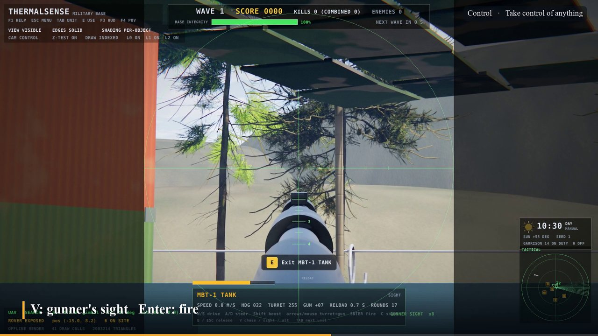<br><sub>The tank from the gunner's sight</sub></td>
<td width="50%">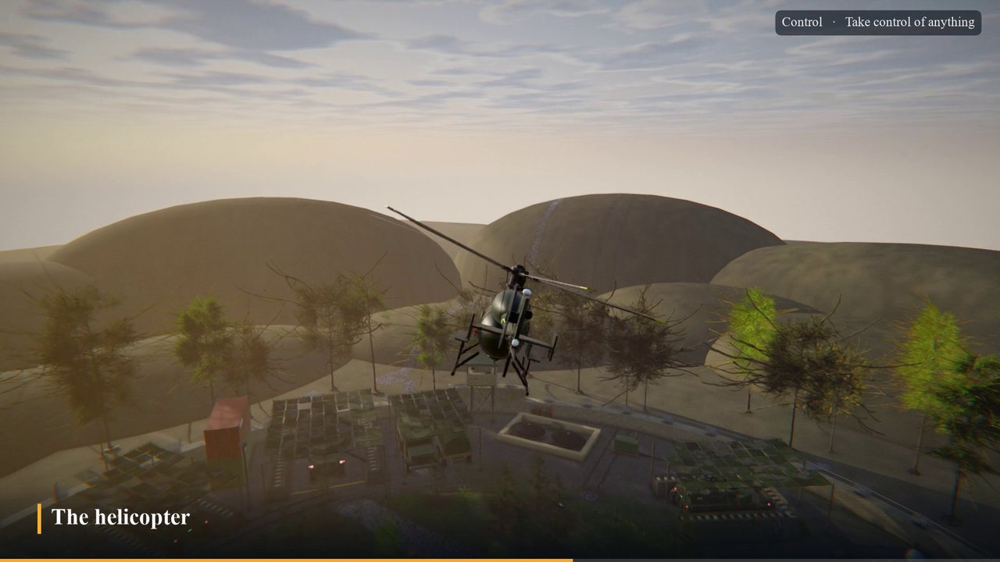<br><sub>The helicopter, started and flown</sub></td>
</tr></table>

<table><tr>
<td width="50%">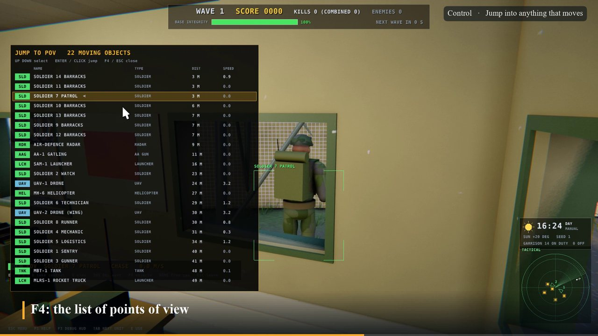<br><sub>F4: every moving object, nearest first</sub></td>
<td width="50%">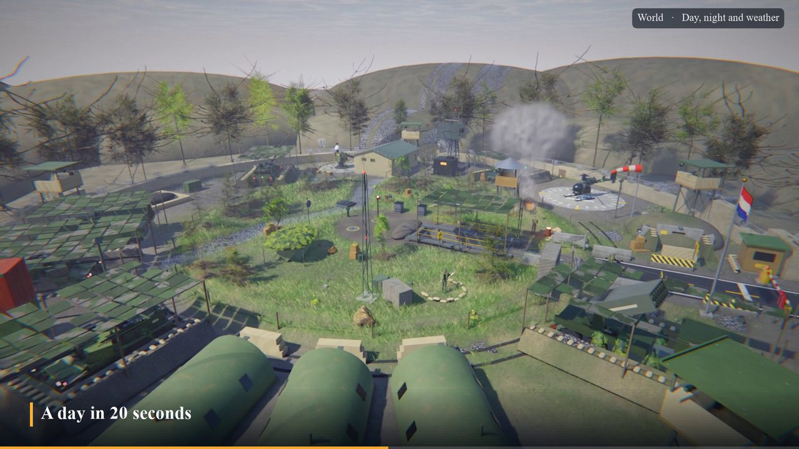<br><sub>One clock drives light, sky, lamps and duties</sub></td>
</tr></table>


## 4. Vision: from a heat picture to a track

<table><tr>
<td width="50%">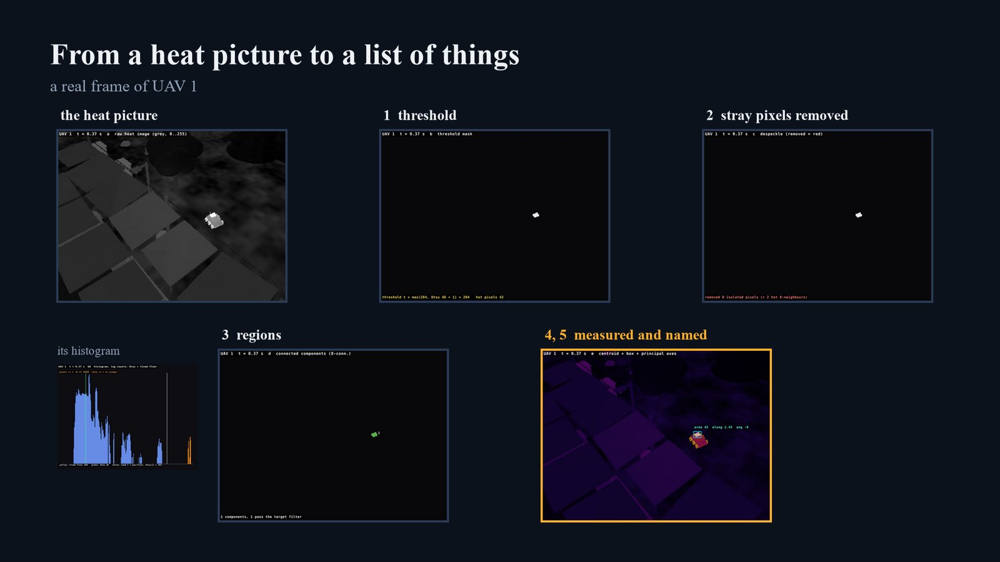<br><sub>Five steps on every 320 x 240 frame</sub></td>
<td width="50%">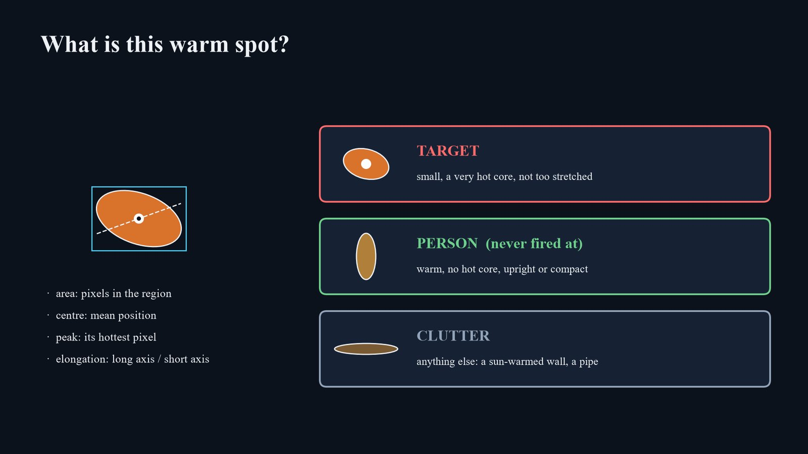<br><sub>Target, person or clutter</sub></td>
</tr></table>

<table><tr>
<td width="50%">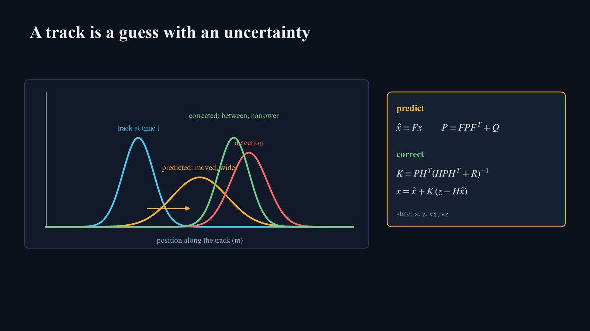<br><sub>A track: predict, then correct</sub></td>
<td width="50%">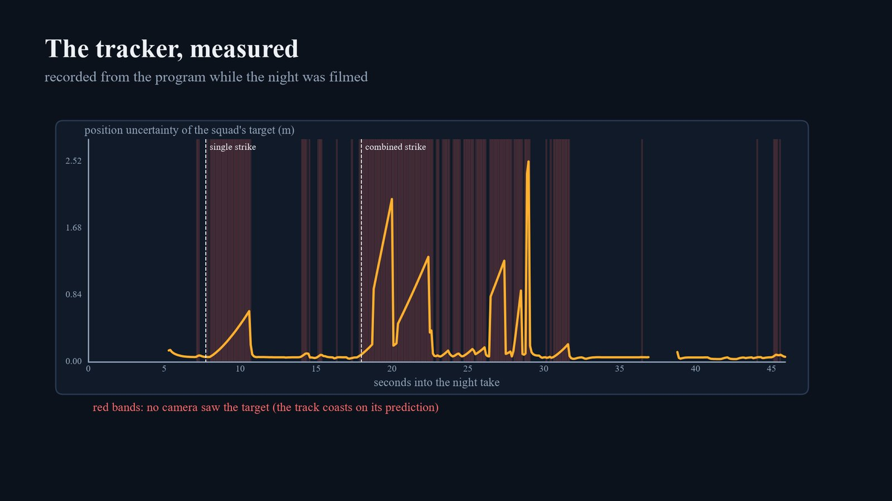<br><sub>Uncertainty of the squad's target during one night (recorded from the program)</sub></td>
</tr></table>


## 5. Agents: the drones, the intruders, the soldiers

| Agent | Algorithm | Constants (from the source) | Code |
| --- | --- | --- | --- |
| Drone pair | lead and wing; combined strike with both rounds arriving together; split for a second, urgent intruder | lock 0.8 s (lead), 0.5 s (wing); waits 8 s for a free wing; split beyond 14 m when within 10 m of an asset; rejoin within 9 m | `src/ai/Squad.cpp` |
| Intruder: route | flood fill (MicroMouse) on a cost map: 1 + exposure to the drones + its own noise field | 80 x 80 cells of 0.5 m | `src/ai/HideController.cpp` |
| Intruder: driving | line follower: 5 sensors, PD controller, differential drive | Kp 3.2, Kd 0.25 | `src/ai/HideController.cpp` |
| Intruder: hiding | a drone within range: flood fill from every cell no drone can see, drive to the nearest | 5 m, 4 s in cover | `src/ai/HideController.cpp`, `src/ai/Occlusion.cpp` |
| Soldier | A* on a grid, string pulling, Catmull-Rom curve; two-link leg inverse kinematics | day shift 6.4 to 17.6 h | `src/scene/Garrison.cpp`, `src/scene/Gait.cpp` |
| Tracker | Kalman filter per target, gating, Hungarian assignment, two-view triangulation | state x, z, vx, vz | `src/vision/MultiTracker.cpp` |

<table><tr>
<td width="50%">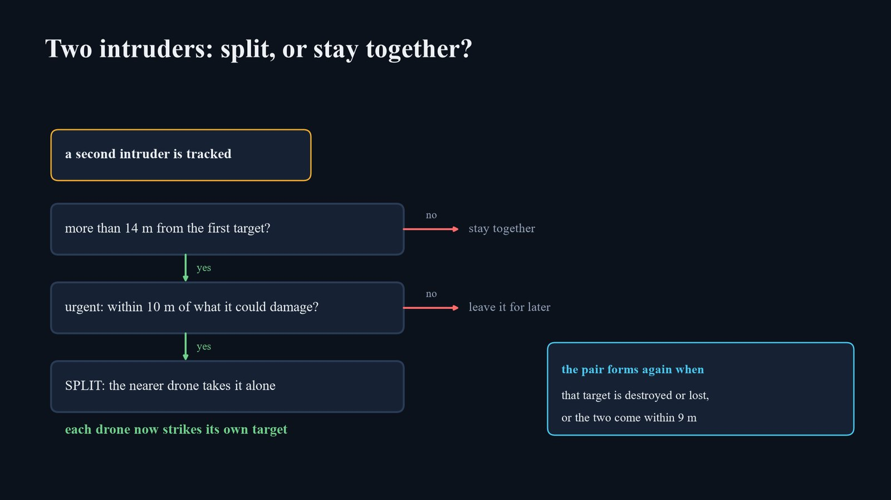<br><sub>Two intruders: split, or stay together?</sub></td>
<td width="50%">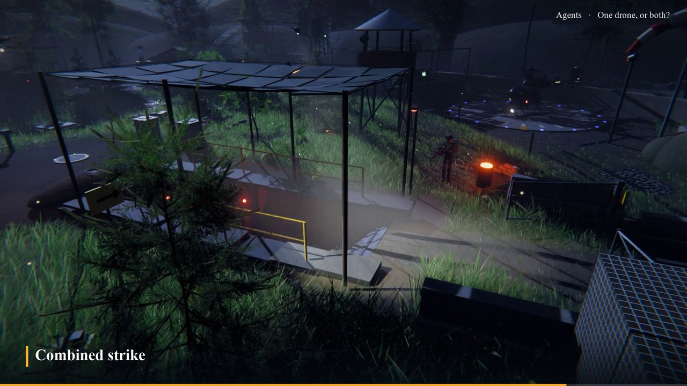<br><sub>A combined strike</sub></td>
</tr></table>

<table><tr>
<td width="50%">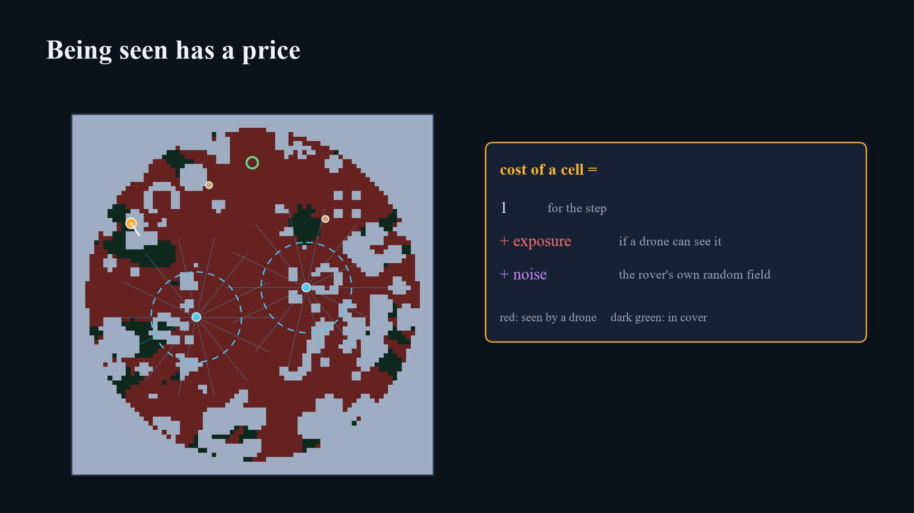<br><sub>The intruder's map: red is seen by a drone, green is cover (recorded from the program)</sub></td>
<td width="50%">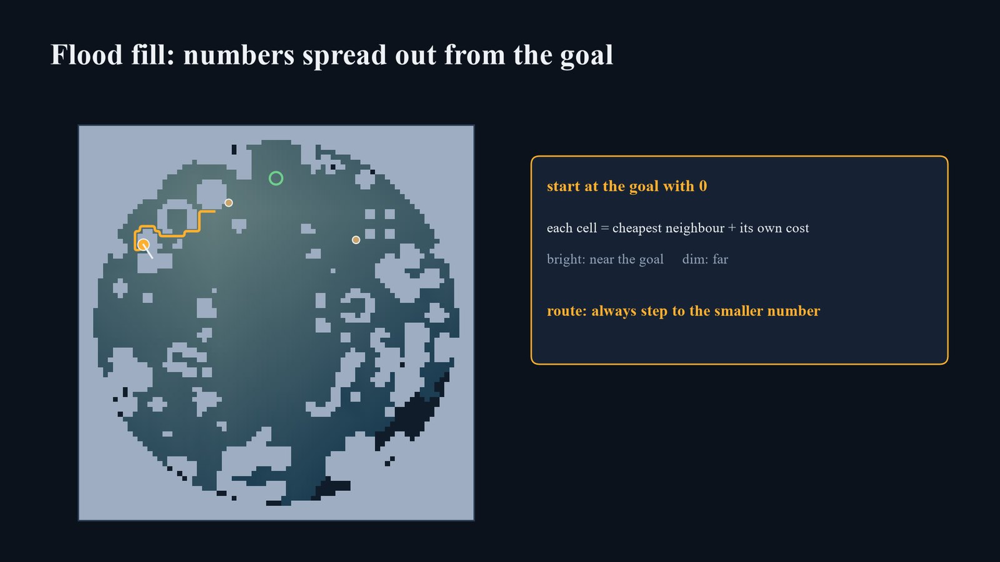<br><sub>Flood fill from the goal; the route follows the smaller numbers</sub></td>
</tr></table>

<table><tr>
<td width="50%">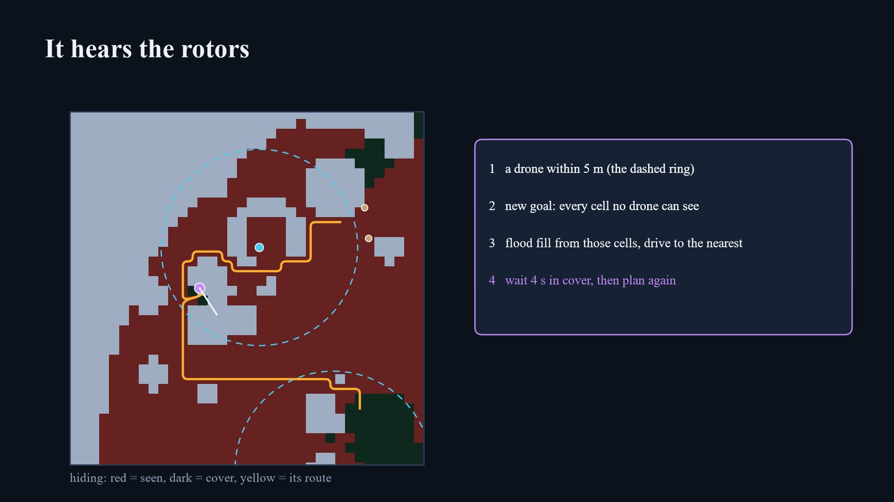<br><sub>It hears a drone and hides</sub></td>
<td width="50%">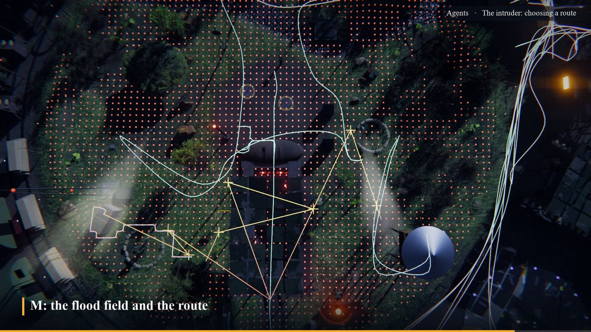<br><sub>Key M: the flood field and the routes in the scene</sub></td>
</tr></table>

<table><tr>
<td width="50%">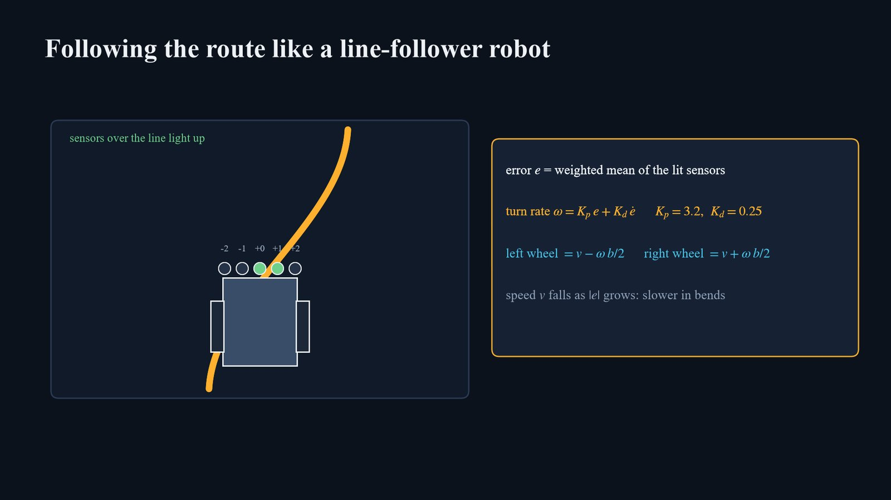<br><sub>Following the route like a line-follower robot</sub></td>
<td width="50%">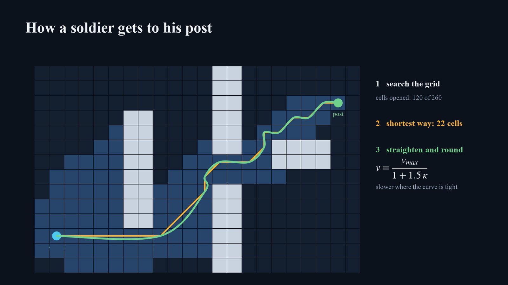<br><sub>How a soldier gets to his post</sub></td>
</tr></table>


## The workbook: one home for every number

`report/workbooks/cg_workbook.xlsx` has 23 sheets. Yellow cells are inputs read from the code or from the program's scene export; white
cells are formulas. It holds the worked examples of every pipeline stage, every number printed in the report (`Report_Numbers`), every
component of the scene in world coordinates (`World_Coordinates`, 6,069 rows), the layout, lights and things that can be operated
(`Layout`), every constant of the algorithms with its source line (`Algorithms`) and the film's shot list (`Film`). The report's number
macros are written from the workbook, and the checkers fail if the program, the workbook and the report disagree:

```
~/.local/bin/uv run -q --with openpyxl --with numpy python tools/report/check_workbook.py      # workbook = export = code = report
~/.local/bin/uv run -q --with openpyxl python tools/report/numbers_from_workbook.py --check   # report macros = workbook
python3 tools/report/check_counts.py && python3 tools/report/check_numbers.py                 # counts and hand-typed numbers
```

## Build and run

| Platform | Command |
| --- | --- |
| Windows | `run.bat` (starts `ThermalSense.exe`; builds it first if missing) |
| Linux | `./build.sh` then `./run.sh` |
| Linux without a display | `make -j HEADLESS=1`, then `./ThermalSense --headless ...` |
| WSL2 window, no sudo | `tools/run_wsl.sh` |
| Tests (396) | `make test` |

Useful options: `--quality low|high|ultra|epic`, `--fullscreen`, `--time 22:00`, `--seed N`, `--record out.mp4 SECONDS`,
`--capture DIR`, `--export-docs FILE`, `--help`. The full key table (more than 120 bindings) is in `src/scene/KeyMap.cpp`, in Section 5
of the report, and on screen with `F1`.

## Repository

| Path | Holds |
| --- | --- |
| `src/primitives` | the 16 mesh generators |
| `src/objects` | every object as a list of parts (size, rotation, position) |
| `src/math` | vectors, matrices, frustum, splines, tone curves, CPU rasteriser |
| `src/scene` | scene graph, soldiers, combat and particles, day cycle, doors, cameras |
| `src/rendering` | shaders (vector mathematics written out in `ShaderMath.cpp`), renderer, post-processing, Frame Explorer |
| `src/raytrace` | ray tracers, intersections, bounding volume hierarchy |
| `src/vision` | thermal sensor model, image pipeline, multi-target tracker |
| `src/ai` | drone squad and flight, intruders (flood fill, line follower, hiding) |
| `src/app` | play, capture, record, export, replay |
| `src/audio` | synthesised sound |
| `tests` | 396 automated tests |
| `tools/film` | the film as data (`acts/*.py`), its plates, score, sound mix and assembler |
| `tools/report, tools/v10` | generators of the report's tables and figures, the workbook, the checkers, this README |
| `report` | LaTeX sources, figures, data, PDF, workbook, slides, films |
| `docs` | film script, code tour, code map, pictures of this page, history |
| `assets` | public-domain (CC0) vegetation meshes and ground textures of the two highest presets (`assets/LICENSES.md`) |

## Regenerating

```
# report and workbook
./ThermalSense --export-docs build/routes_export.json && cp build/routes_export.json report/data/scene_export_v10.json
python3 tools/v10/gen_numbers.py report/data/scene_export_v10.json
python3 tools/v10/build_cg_workbook.py --export report/data/scene_export_v10.json    # with uv: --with openpyxl --with matplotlib --with numpy
python3 tools/report/gen_designs.py && python3 tools/report/abbrev_pages.py          # Section 7; short forms per page; builds the PDF
# film (narration -> takes on the GPU -> plates -> picture -> sound -> master)
U="uv run -q --python 3.12 --with edge-tts --with soundfile --with numpy --with scipy --with pillow --with matplotlib --with openpyxl python tools/film/build.py"
$U voice && $U takes && $U events && $U plates && $U plan && $U picture && $U sound && $U final
python3 tools/film/figures.py && python3 tools/report/gen_readme.py                  # pictures and text of this page
```

`tools/film/build.py takes` records the 33 takes made for this film. Thirteen more recordings are reused from the short film and are
not re-recorded by it: six soldier tours (tank, bunker, generator room, barracks hall, anti-aircraft gun, missile launcher; their
scripts are in `tools/film/tours`, played with `TS_TOUR`), three views of the camp on alert, two views of the night, and the drones'
take-off and landing (camera glides with `TS_FILM_CAM`). A rebuild from a clean clone needs those files in `build/film3` and `build/film2`.

The narration is a synthetic voice (Microsoft's Andrew, through `edge-tts`; `--engine kokoro` uses a local model instead);
`tools/film/build.py sound --voice-track FILE` uses a recorded voice. The score is written in `tools/film/score.py`, and every sound
of the program is synthesised (`src/audio`).
